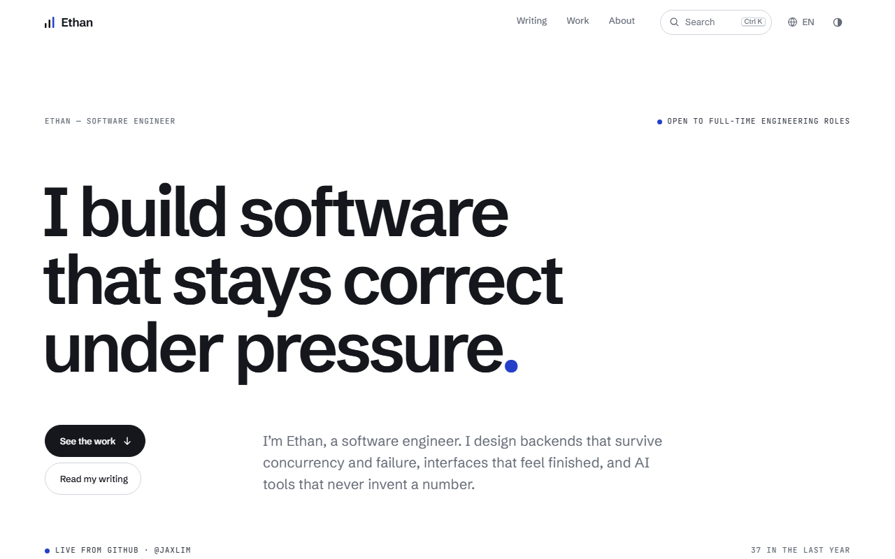
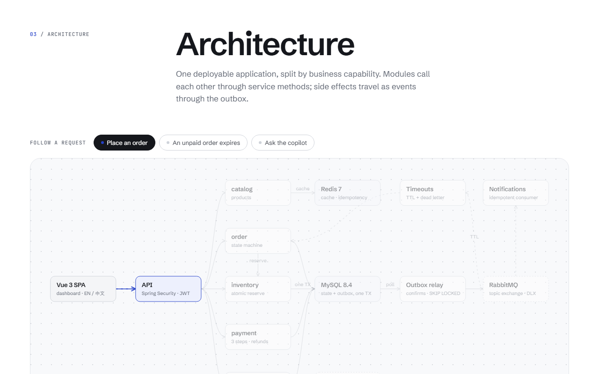
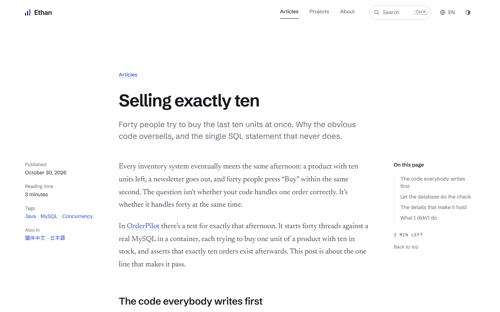
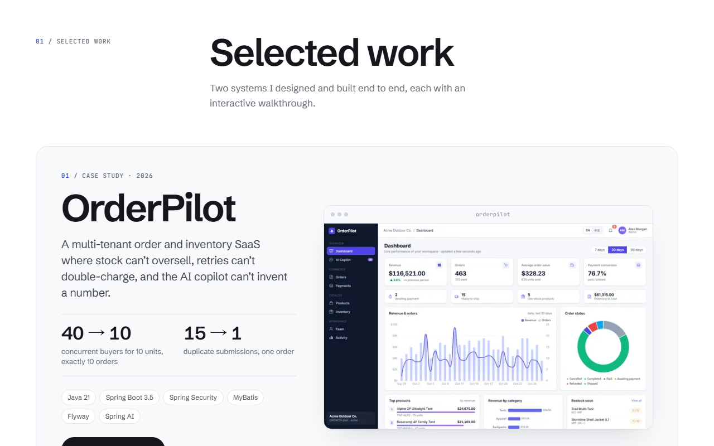

[简体中文](README.md) | **English**

# personal-blog

My portfolio and technical blog, live at [jaxlim.github.io/personal-blog](https://jaxlim.github.io/personal-blog/).

The site presents case studies of systems I have built, technical writing, and my GitHub activity, kept up to date. It is available in English, Simplified Chinese and Japanese. It is built with [Astro](https://astro.build) and TypeScript and outputs static HTML: no server, no tracking.



## Status

- **Live**: deployed to GitHub Pages by GitHub Actions, rebuilt on every push to `main` and every six hours.
- **Content**: two case studies ([OrderPilot](https://github.com/JaxLim/OrderPilot) and [OperationAgent](https://github.com/JaxLim/OperationAgent)); two articles, each in English, Chinese and Japanese; plus a formatting-reference draft that is only visible in local development.
- **Optional, not configured yet**: the footer email link (hidden while `email` is empty) and the About-page portrait (hidden while `src/assets/portrait.jpg` doesn't exist).

## Features

| Area | What it includes |
| --- | --- |
| Case studies | The hard problems and the tests behind them, an interactive architecture diagram (select a part, or play a request through the system), and a demo: an oversell lab for OrderPilot (forty buyers, ten units) and a security-gate console for OperationAgent |
| Articles | Table of contents with scroll spy, minutes-left counter, code blocks with file titles, highlights, diffs and a copy button, footnote previews, zoomable figures, previous/next links |
| GitHub activity | Contribution calendar (the "pulse" on the home page), latest push with its commit message, every public repository with sorting and a language filter; open pages keep themselves current |
| Languages | Separate URLs (`/`, `/zh/`, `/ja/`), a remembered choice, `hreflang`, a sitemap and an RSS feed per language, typography tuned for CJK |
| Link previews | An Open Graph image is generated at build time for every page, article and case study, in each language |
| Motion | Smooth scrolling, scroll reveals and page transitions, all turned off under `prefers-reduced-motion` |

| Case study · architecture diagram | Article page |
| --- | --- |
|  |  |



## Technical overview

- **Framework**: Astro 7 (static output) + TypeScript; articles in Markdown / MDX, highlighted with Shiki.
- **Content**: articles are an Astro content collection (`src/content/posts/{en,zh,ja}/`). Case studies are typed TypeScript files (`src/work/`) where every string is written in all three languages, so the type checker reports any missing translation.
- **GitHub data**: `scripts/fetch-github.mjs` runs before each build and writes `src/data/github.json`, which is committed on purpose. Repositories, events and the contribution calendar are fetched separately; if one source fails its saved copy is kept, so builds also work offline. In the browser, `src/scripts/live.ts` polls the public events API, respecting ETags and `X-Poll-Interval`, and pauses while the tab is hidden.
- **Generated images**: link previews are drawn with satori and rendered to PNG with `@resvg/resvg-js`.
- **Fonts**: Schibsted Grotesk, Newsreader and JetBrains Mono, with Noto Serif for Chinese and Japanese articles; all self-hosted through Fontsource.

## Run it locally

Requires **Node.js 22.12 or newer**.

```sh
git clone https://github.com/JaxLim/personal-blog.git
cd personal-blog
npm install
npm run dev
```

Open http://localhost:4321 . The Chinese version is at http://localhost:4321/zh/ .

`npm run dev` first copies the fonts and refreshes GitHub data if `src/data/github.json` is more than 30 minutes old. It also starts without a network connection, showing the saved data.

### Commands

| Command | What it does |
| --- | --- |
| `npm run dev` | Starts the development server |
| `npm run build` | Fetches GitHub data, then builds the site into `dist/` |
| `npm run preview` | Serves the built site locally |
| `npm run check` | Type-checks everything, including every translation |
| `npm run github` | Fetches GitHub data now |
| `npm run new "Title" -- --lang zh` | Starts a draft post (`--md` for plain Markdown, `--slug` to choose the file name) |

### Environment variables (optional)

Copy `.env.example` to `.env` and fill in what you need:

| Variable | Used for |
| --- | --- |
| `SITE_URL` | The public origin: canonical URLs, `hreflang`, RSS, sitemap and link previews |
| `BASE_PATH` | Serving from a sub-path, e.g. `/personal-blog` |
| `GITHUB_TOKEN` | A token with no scopes. Gives the exact contribution calendar and a higher API rate limit. Used only at build time, never sent to the browser |

## Deploying

`.github/workflows/deploy.yml` builds and publishes to GitHub Pages on every push to `main`, every six hours, and on demand from the Actions tab. One-time setup: **Settings → Pages → Source: GitHub Actions** (already done for this repository). The workflow sets `SITE_URL` and `BASE_PATH` from the Pages configuration, so a project URL, a user site and a custom domain all work without code changes.

To host elsewhere (Vercel, Netlify, Cloudflare Pages), run `npm run build`, publish `dist/`, and set `SITE_URL` to the public origin. Set `BASE_PATH` only if the site isn't served from the root.

## Editing content

- **Personal details**: `src/site.config.ts` (name, headline, tagline, About text, links, GitHub username, email).
- **Repository notes**: `src/content/projects.yaml` (descriptions per language, featured order, hidden repositories).
- **Articles**: `src/content/posts/{en,zh,ja}/`. A file with the same name in another language folder is its translation. `src/content/posts/en/writing-posts-on-this-site.mdx` shows every formatting element (a draft, visible only in `npm run dev`).

  ```yaml
  ---
  title: Selling exactly ten
  description: One or two sentences for lists and link previews.
  date: 2026-10-30
  tags: [Java, MySQL]
  pinned: true          # optional: first on the home page
  draft: true           # optional: only visible in development
  project: orderpilot   # optional: links the case study at the end
  ---
  ```

- **Case studies**: add a file in `src/work/` (see `types.ts`) and list it in `src/work/index.ts`. Screenshots go in `src/assets/work/` and are resized and converted at build time.

## Project structure

```
src/
  pages/        routes; [lang]/ holds the /zh/ and /ja/ versions; og/ generates link previews
  views/        page templates shared by every language
  components/   UI; work/ has the diagram, demos and case-study cards
  work/         case-study content (typed, trilingual)
  content/      articles and projects.yaml
  data/         github.json, written by scripts/fetch-github.mjs
  i18n/         languages, URL helpers and all interface text
  lib/          articles, GitHub data, formatting, OG image rendering
  scripts/      browser code: motion, live data, search, diagram, UI
  styles/       design tokens, global styles, article typography
scripts/        fetch-github, copy-fonts, new-post, make-icons
```
